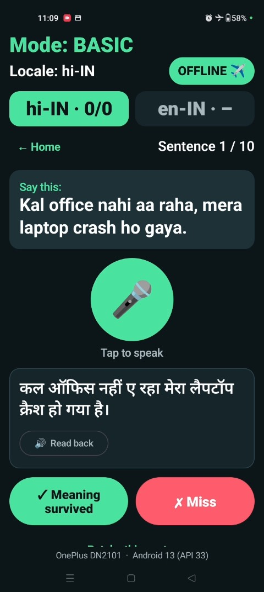
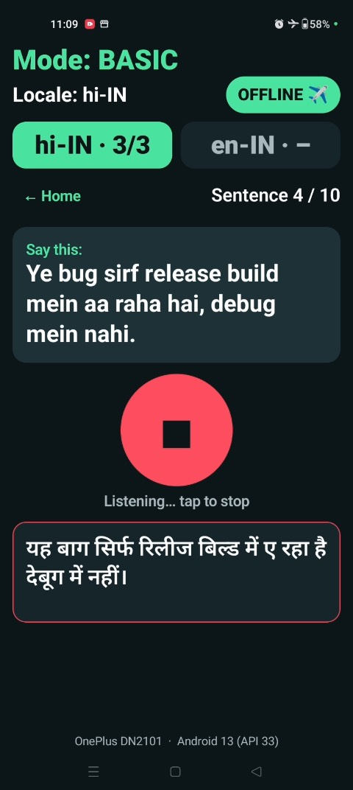
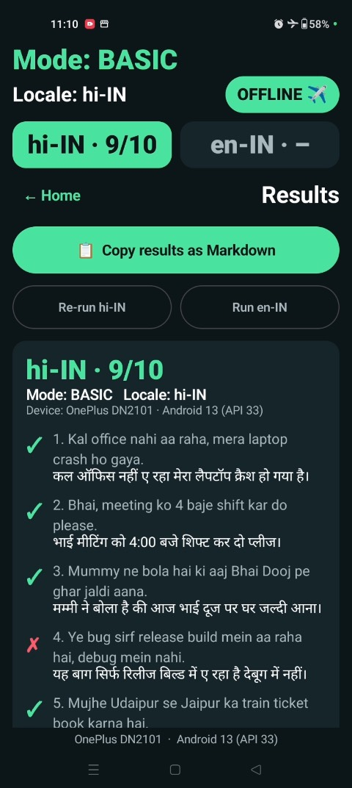

# Offline Hinglish ASR

A small Android app for stress-testing Google's **ML Kit GenAI Speech Recognition API (alpha)** on
real, non-Pixel phones, using everyday **Hinglish** (code-mixed Hindi + English) sentences. The UI is
built for screen recording: large mode, locale, and score labels, plus an **OFFLINE ✈️ / ONLINE** badge
that shows airplane mode was on.

## Headline result

**hi-IN · BASIC mode · airplane mode: 9/10 sentences kept their meaning** on a OnePlus Nord 2 5G
(MediaTek Dimensity 1200, Android 13), a phone that is not on Google's supported-device list. This is
human speech from a single speaker, judged by hand. ADVANCED mode (Gemini Nano) is `UNAVAILABLE` on this chipset.

| Live transcription | The one miss | Results |
|---|---|---|
|  |  |  |

Things to notice:
- **hi-IN writes everything in Devanagari**, English words included: लैपटॉप क्रैश, यूपीआई पेमेंट, पीआर मर्ज.
- **The only outright miss is dev jargon:** "bug" became बाग ("garden"), and "debug" became देबूग.
- **Near misses that still got ✓:**
  - "Chhath" became छत ("roof")
  - "recomposition" became "मेरी कंपोजिशन"
  - "Android" became "नड्रॉयड"
  - "kaam" became "कम"
- **en-IN is a different story.** On sentence 1 it gave *"Cal office Nahin. A Raha Mera laptop Crush. Ho Gaya."*
  It forces the Hindi words into English spellings and words. The full en-IN run is not recorded yet.

## Screenshots

**Real run on an emulator** (API 36.1 with Google Play). ML Kit reports `UNAVAILABLE` in both modes, and airplane mode is on:


**UI walkthrough.** These come from the instrumented UI test (`TestModeFlowTest`), which uses a *scripted*
recognizer because ML Kit is unavailable on the emulator. The transcripts and scores are test data,
**not real ASR results**.

| Home + read-back | Test: listening (partial text) | Test: judge |
|---|---|---|
|  |  |  |

| Results: both locales | Model download |
|---|---|
|  |  |

## What it tests

- **Feature status** for the chosen locale (`AVAILABLE` / `DOWNLOADABLE` / `DOWNLOADING` / `UNAVAILABLE`),
  with a **Download model** button and a progress bar.
- **Mode:** it asks for `MODE_ADVANCED` (GenAI / Gemini Nano) first and falls back to `MODE_BASIC`
  when ADVANCED reports `UNAVAILABLE`.
- **Locale:** `hi-IN` vs `en-IN`, set through `speechRecognizerOptions { locale = … }`.
  hi-IN is documented (beta) for both modes. en-IN is **not** in the documented list for either mode,
  so the app just reports whatever status the device returns.
- **Fully offline recognition** from the mic. Partial text shows in grey and final text in white.
- **Read-back (optional):** ML Kit GenAI Text-to-Speech, with a fallback to the platform `TextToSpeech`.
  The UI labels which engine spoke.

## Stack

Kotlin · Jetpack Compose · Material 3 · single activity · one `AndroidViewModel` · version catalog ·
minSdk 31 · AGP 9.5.1 · Kotlin 2.4.21 · Gradle 9.9.1 · Compose BOM 2026.09.00

| Artifact | Version |
|---|---|
| `com.google.mlkit:genai-speech-recognition` | `1.0.0-alpha2` |
| `com.google.mlkit:genai-text-to-speech` | `1.0.0-alpha1` |
| `com.google.mlkit:genai-common` (transitive) | `1.0.0-beta5` |

## Run it

```bash
./gradlew :app:installDebug
adb shell am start -n com.akshay.offlineasr/.MainActivity
```

1. Launch with internet on and grant the mic permission. If the status says `DOWNLOADABLE`, tap **Download model**.
2. Turn on **airplane mode**. The badge switches to **OFFLINE ✈️**.
3. Tap **Start 10-sentence test**. For each sentence, tap the mic, read the sentence, tap stop, then judge it:
   **✓ Meaning survived** or **✗ Miss**. Spelling variants and Devanagari vs Roman script both count as correct.
4. On the results screen, tap **Run en-IN** to repeat the test in the other locale. Both scores appear side by side.
5. Tap **Copy results as Markdown** and paste the output into the table below.

## The 10 sentences

1. Kal office nahi aa raha, mera laptop crash ho gaya.
2. Bhai, meeting ko 4 baje shift kar do please.
3. Mummy ne bola hai ki aaj Bhai Dooj pe ghar jaldi aana.
4. Ye bug sirf release build mein aa raha hai, debug mein nahi.
5. Mujhe Udaipur se Jaipur ka train ticket book karna hai.
6. Ek kaam karo, PR merge karne se pehle tests chala lo.
7. Chhath ke liye Bihar ki saari trains full hain yaar.
8. Mera UPI payment fail ho gaya but paisa kat gaya.
9. Compose mein recomposition bahut zyada ho raha hai.
10. Weekend pe Android Engineers ka meetup hai, aa jaana.

## Results

| Device | Mode | Locale | Score | Missed words |
|---|---|---|---|---|
| Android Emulator (sdk_gphone64_arm64, Android 16 / API 36.1, Google Play) | NONE — ADVANCED & BASIC both `UNAVAILABLE` | hi-IN | n/a (could not run) | n/a |
| Android Emulator (sdk_gphone64_arm64, Android 16 / API 36.1, Google Play) | NONE — ADVANCED & BASIC both `UNAVAILABLE` | en-IN | n/a (could not run) | n/a |
| OnePlus Nord 2 5G (DN2101, Dimensity 1200 MT6893, Android 13), Speech Services 210693705, airplane mode | **BASIC** (ADVANCED `UNAVAILABLE`) | hi-IN | **9/10** | bug → बाग, debug → देबूग (✗). Accepted near misses: Chhath → छत, recomposition → मेरी कंपोजिशन, Android → नड्रॉयड, kaam → कम |
| OnePlus Nord 2 5G (same) | BASIC | en-IN | not finished (1 sentence recorded) | "Kal … nahi aa raha … crash" → "Cal office Nahin. A Raha Mera laptop Crush. Ho Gaya." |
|  |  |  |  |  |

Getting the Nord 2 to work took two fixes:
1. Speech Services was version `210645707`, below ML Kit's hidden minimum of `210665810`, so ML Kit reported `UNAVAILABLE`. Updating it from Play fixed that.
2. Right after the update, Speech Services answered `PERMISSION_DENIED: Api access revoked`. Some time later, BASIC became available. hi-IN needed a one-time model download, while en-IN was already on the phone.

<details><summary>hi-IN transcripts (Nord 2, BASIC, offline)</summary>

| # | Said | Transcript | ✓/✗ |
|---|---|---|---|
| 1 | Kal office nahi aa raha, mera laptop crash ho gaya. | कल ऑफिस नहीं ए रहा मेरा लैपटॉप क्रैश हो गया है। | ✓ |
| 2 | Bhai, meeting ko 4 baje shift kar do please. | भाई मीटिंग को 4:00 बजे शिफ्ट कर दो प्लीज। | ✓ |
| 3 | Mummy ne bola hai ki aaj Bhai Dooj pe ghar jaldi aana. | मम्मी ने बोला है की आज भाई दूज पर घर जल्दी आना। | ✓ |
| 4 | Ye bug sirf release build mein aa raha hai, debug mein nahi. | यह बाग सिर्फ रिलीज बिल्ड में ए रहा है देबूग में नहीं। | ✗ |
| 5 | Mujhe Udaipur se Jaipur ka train ticket book karna hai. | मुझे उदयपुर से जयपुर का ट्रेन टिकट बुक करना है। | ✓ |
| 6 | Ek kaam karo, PR merge karne se pehle tests chala lo. | एक कम करो। पीआर मर्ज करने से पहले टेस्ट चला लो। | ✓ |
| 7 | Chhath ke liye Bihar ki saari trains full hain yaar. | छत के लिए बिहार के सारी ट्रेनस फुल है यार। | ✓ |
| 8 | Mera UPI payment fail ho gaya but paisa kat gaya. | मेरा यूपीआई पेमेंट फैल हो गया बट पैसा कट गया। | ✓ |
| 9 | Compose mein recomposition bahut zyada ho raha hai. | कंपोज मेरी कंपोजिशन बहुत ज्यादा हो रहा है। | ✓ |
| 10 | Weekend pe Android Engineers ka meetup hai, aa jaana. | वीकएंड पे नड्रॉयड इंजिनियर्स का मीट अप है ए जना | ✓ |

</details>

Use **Copy results as Markdown** in the app to add your own device.

## Tests

Run these on an emulator or a phone:

```bash
./gradlew :app:installDebug :app:installDebugAndroidTest
adb shell am instrument -w com.akshay.offlineasr.test/androidx.test.runner.AndroidJUnitRunner
```

- `TestModeFlowTest` drives the real UI and the real test-mode state logic with a **scripted** recognizer.
  It covers 10 sentences in hi-IN (7/10), a full en-IN run (10/10), both scores side by side, the copied
  Markdown, and the UNAVAILABLE and DOWNLOADING screens. Screenshots are saved to
  `/sdcard/Android/data/com.akshay.offlineasr/files/shots/`. The scripted recognizer exists only in tests
  and never ships in the app.
- `TtsEngineTest` runs the **real** TTS path and reports which engine spoke.

Emulator result (Pixel-class AVD, API 36.1 with Google Play, arm64): ADVANCED and BASIC are both
`UNAVAILABLE` for hi-IN and en-IN. The image has no AICore, and its Speech Services app is from Aug 2025.
ML Kit TTS returns no voices there, so the app falls back to platform TTS. You need a real device for real results.

## Caveats (alpha API)

- The API only lets you *request* a mode (`preferredMode`). It has no getter for the mode actually in
  use, so the "Mode" label shows the requested mode on the first client whose `checkStatus()` was not `UNAVAILABLE`.
- Google documents ADVANCED for Pixel 10/11 and Gemini Nano chipsets only. It is not supported on devices
  with an unlocked bootloader.
- ML Kit GenAI TTS officially supports a short list of devices (Pixel 8+, Galaxy S25/S26 and a few others)
  and has no en-IN voice. On other devices the app falls back to platform TTS and says so.
- **Bug in `genai-text-to-speech:1.0.0-alpha1`:** the documented call `speechSynthesizerOptions(Locale.US)`
  compiles but throws `NoSuchMethodError: speechSynthesizerOptions$default` at runtime, because the AAR
  has no Kotlin default-argument bridge. Workaround: pass the lambda explicitly, as in
  `speechSynthesizerOptions(locale) {}`.
- **Hidden minimum Speech Services version.** `genai-speech-recognition:1.0.0-alpha2` reads the version code of
  `com.google.android.tts` ("Speech Recognition & Synthesis from Google"). If it is below **210665810**, every
  `checkStatus()` returns `UNAVAILABLE` immediately, for every locale and mode, without contacting the service.
  The docs only say "latest version". The app shows the installed and required versions, plus an
  **Update in Play Store** button.
- **After that gate:** on a OnePlus Nord 2 (MT6893, Android 13), Speech Services `210693705` was reachable but
  answered `PERMISSION_DENIED: Api access revoked` in both modes. Speech Services decides this itself. It may
  be a delay in rolling out its configuration, or the device may not be enabled for the alpha.
- **Docs mismatch in `genai-speech-recognition:1.0.0-alpha2`:** the docs show `download` as a property,
  but the API is a function, `download()`.

Docs: [Speech recognition](https://developers.google.com/ml-kit/genai/speech-recognition/android) ·
[Text to speech](https://developers.google.com/ml-kit/genai/text-to-speech/android)
